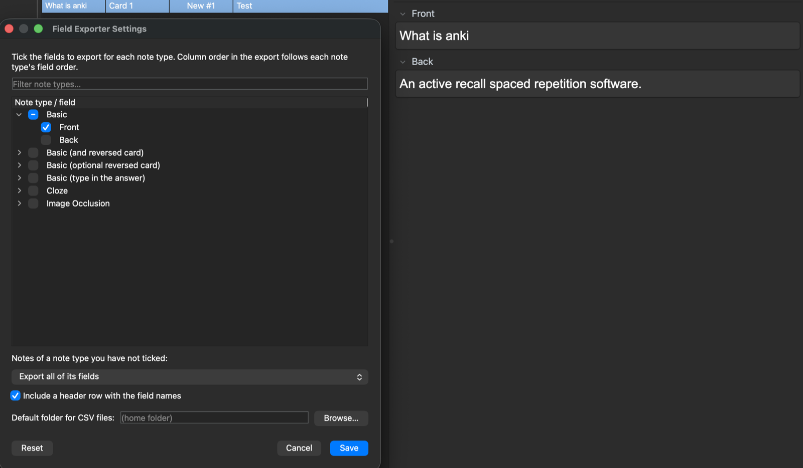
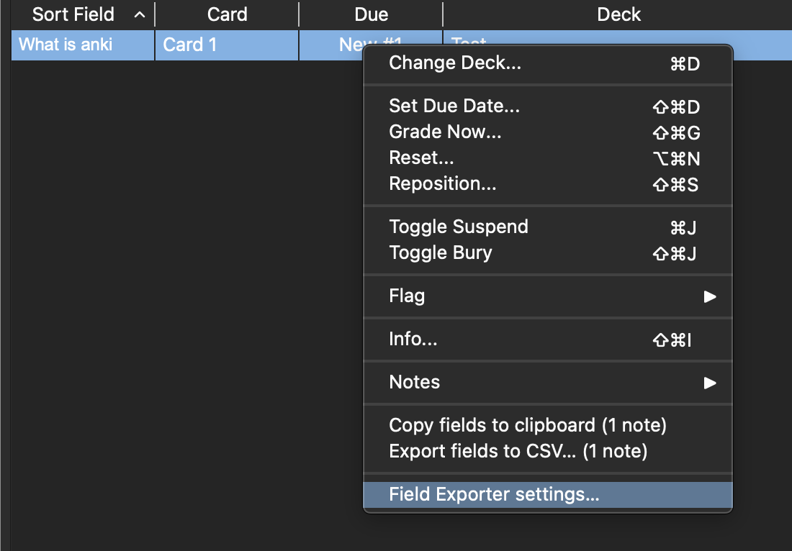

# Field Exporter for Anki

Right-click any selection in Anki's **Browser** and either copy the fields you
care about to the clipboard, or save them as a `.csv`. Which fields get exported
is set once per note type — pick them in a dialog, no JSON needed.

Built for people who reuse their card content elsewhere: pasting into notes,
docs, spreadsheets, or an LLM.

[](https://apps.ankiweb.net)
[](LICENSE)
[](https://github.com/dyzur/Anki-Field-Exporter-Addon/actions/workflows/tests.yml)
[](https://ankiweb.net/shared/info/1114764677)





## Usage

1. **Tools → Field Exporter…** → tick the fields you want for each note type
   (use the filter box if you have many) → **Save**.
2. In the Browser, select the notes you want and **right-click**:

```
────────────────────────────
Copy fields to clipboard (12 notes)
Export fields to CSV… (12 notes)
────────────────────────────
Field Exporter settings…
```

- **Copy fields to clipboard** — tab-separated text with a header row; paste
  straight into Excel, Numbers, Google Sheets, or a text field.
- **Export fields to CSV…** — save dialog with a timestamped default name.
  Written as UTF-8 with BOM so Excel and Numbers show accented characters
  correctly.
- Both entries grey out when nothing is selected, and the count is the number of
  *notes* — a note with several selected cards is exported once.

Note types you haven't configured follow the **Notes of a note type you have not
ticked** option: export all of their fields, or skip them. The tooltip after each
export tells you which path was taken.

## Output format

- Field HTML becomes plain text: `<br>` and block ends become line breaks,
  entities are decoded, images become `[image: filename]`, `<style>`/`<script>`
  are dropped. Cloze markup (`{{c1::…}}`) and `[sound:…]` are kept as-is.
- Clipboard text is TSV with `\n` line endings; CSV is comma-separated,
  RFC-4180 quoted, `\r\n` line endings.
- A cell containing a comma, tab, quote or line break is quoted in both formats,
  so multi-line fields keep their shape.

## Install

**From AnkiWeb:** Tools → Add-ons → Get Add-ons… → paste `1114764677`, or open
<https://ankiweb.net/shared/info/1114764677> and click *Download*.

**Manual / development:**

```bash
make install       # rsync into addons21/anki_field_exporter
```

Restart Anki afterwards. An existing `config.json` is never overwritten, so your
settings survive updates.

Requires Anki 2.1.50 or newer (desktop). Not compatible with AnkiMobile or
AnkiDroid — they cannot run add-ons.

## Configuration

Everything can be set in the dialog — that is the recommended way. The same
settings are reachable as JSON via **Tools → Add-ons → Field Exporter → Config**
(see also `config.md`). Anki stores what you save in the add-on's `meta.json`;
the `config.json` shipped with the add-on is the starting default:

```json
{
  "notetype_fields": {
    "Basic": ["Front", "Back"]
  },
  "unconfigured_notetype": "all_fields",
  "include_header_row": true,
  "csv_directory": ""
}
```

`notetype_fields` maps note type name → field names. The dialog writes the
fields in each note type's own order; edit the JSON if you want a different
column order.

## Development

```
__init__.py     menu wiring, clipboard + CSV actions (thin Qt layer)
exporter.py     HTML→text, field resolution, TSV/CSV serialization (no Anki imports)
settings.py     the settings dialog
config.json     default config shipped with the add-on
config.md       help text shown in Anki's config editor
```

Tests:

```bash
make test                     # all three suites
python3 tests/test_exporter.py    # unit tests, any python3 — no Anki needed
make integration                  # uses Anki's bundled Python
```

`tests/test_with_anki.py` builds a throwaway collection in a temp directory and
checks parsing/CSV output against real note objects; `tests/test_gui_wiring.py`
drives the real Qt widgets headlessly to check the context menu, clipboard and
settings dialog. Neither touches a real collection. CI runs the unit suite only
(the others need an Anki installation).

Build the release file:

```bash
make release
# dist/anki_field_exporter.ankiaddon  -> upload to ankiweb.net/shared/addons
```

`make release` bumps `mod` in `manifest.json` (Anki's update check uses it) and
zips the shipped files only — tests, docs and your personal config are excluded.

## Publishing notes

Repo: <https://github.com/dyzur/Anki-Field-Exporter-Addon> · AnkiWeb: <https://ankiweb.net/shared/info/1114764677>

AnkiWeb stores a snapshot of the zip, so the two are kept in sync by rule:
**every zip uploaded to AnkiWeb is built from a commit that is pushed.**

Screenshots live in `docs/images/`. GitHub renders them from the repo; the
AnkiWeb listing can't host images, so its description embeds the raw URLs
instead (`https://raw.githubusercontent.com/dyzur/Anki-Field-Exporter-Addon/main/docs/images/...`).
GIFs work in AnkiWeb descriptions; videos do not.

Releasing an update:

```bash
make release                                    # bumps "mod", rebuilds dist/
# AnkiWeb: your add-on -> Upload update -> dist/anki_field_exporter.ankiaddon
git commit -am "Release 1.0.2" && git push && git tag v1.0.2 && git push --tags
```

Anki shows users an update prompt when `mod` increases, so it must be bumped for
every upload. The add-on's AnkiWeb ID is written by AnkiWeb into `meta.json` at
install time — it is not a `manifest.json` key.

## Licence

AGPL-3.0 — see [LICENSE](LICENSE). Same licence as Anki itself.
