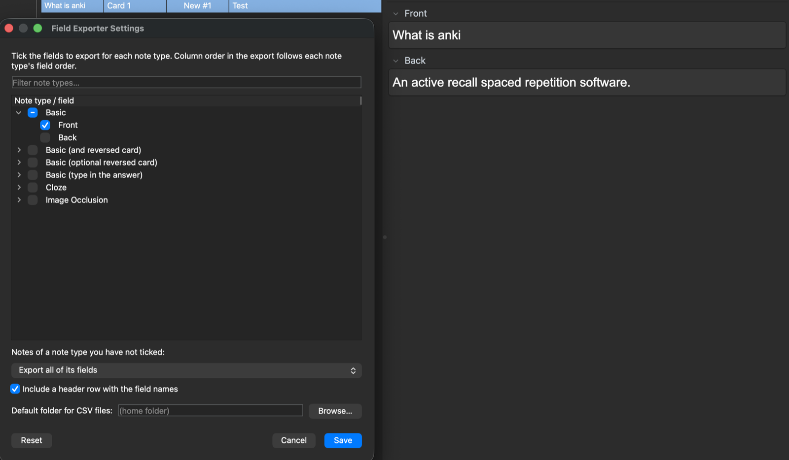
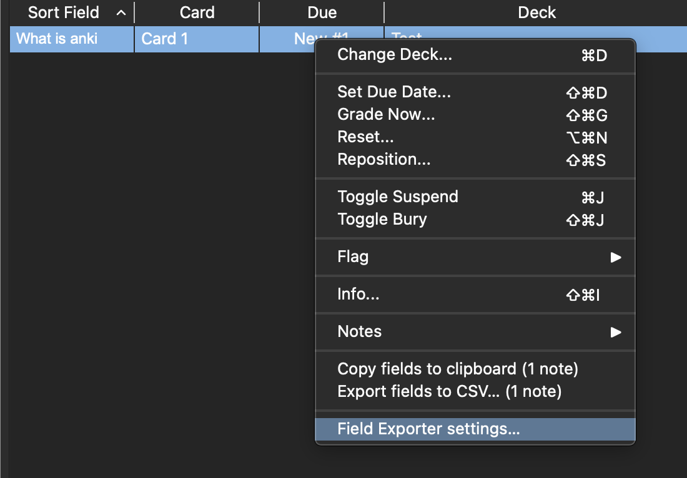

# Maintaining Field Exporter

Everything in here is for whoever builds and publishes the add-on. Users only
need the [README](../README.md).

## Layout

```
__init__.py     menu wiring, clipboard + CSV actions (thin Qt layer)
exporter.py     HTML→text, field resolution, TSV/CSV serialization (no Anki imports)
settings.py     the settings dialog
config.json     default config shipped with the add-on
config.md       help text shown in Anki's config editor
manifest.json   package name, version, mod (update counter), min Anki version
install.sh      rsync the source into Anki's addons21 folder
docs/images/    screenshots used by the README and the AnkiWeb listing
```

`exporter.py` deliberately imports nothing from Anki, so the bulk of the logic
is testable with any Python.

## Install locally

```bash
make install        # or ./install.sh
```

Copies the source to `~/Library/Application Support/Anki2/addons21/anki_field_exporter`
and **never overwrites an existing `config.json`**, so your own settings survive.
Restart Anki afterwards.

Note: Anki keeps *saved* settings in the add-on's `meta.json` (written by
`AddonManager.writeConfig`), not in `config.json`. `config.json` is only the
shipped default. If your personal settings ever seem ignored, that's why — check
`meta.json` in the installed folder.

## Tests

```bash
make test                             # all suites
python3 tests/test_exporter.py        # unit tests, any python3, no Anki needed
make integration                      # needs Anki's bundled Python
```

`tests/test_with_anki.py` builds a throwaway collection in a temp directory and
checks parsing/CSV output against real note objects. `tests/test_gui_wiring.py`
and `tests/test_settings_dialog.py` drive the real Qt widgets headlessly
(offscreen) to check the context menu, clipboard, settings dialog and config
saving. `tests/_anki_qt.py` bootstraps Anki's Python and Qt for those suites.
The real collection is never touched.

CI (`.github/workflows/tests.yml`) runs the unit suite on Python 3.13 — the
version Anki currently bundles — plus a packaging check. The Qt suites need an
Anki installation, so they only run locally.

The code must stay **Python 3.9-compatible**, because Anki 2.1.50 (our floor)
ships 3.9. GitHub's runner images no longer offer a 3.9 build, so that check is
manual: `python3 tests/test_exporter.py` with a 3.9 interpreter (macOS ships one
at `/usr/bin/python3`).

## Releasing

AnkiWeb stores a snapshot of the zip, so the rule is: **every zip uploaded to
AnkiWeb is built from a commit that is pushed.**

```bash
make release        # bumps "mod" in manifest.json, rebuilds dist/*.ankiaddon
# AnkiWeb -> your add-on -> Upload update -> dist/anki_field_exporter.ankiaddon
git commit -am "Release X.Y.Z" && git push
git tag vX.Y.Z && git push --tags
```

- `mod` is what Anki compares to decide whether to prompt users to update — it
  must increase on every upload. `make release` does that for you; `make package`
  builds without bumping.
- Bump `human_version` in `manifest.json` when the change is user-visible.
- The zip contains only `__init__.py exporter.py settings.py manifest.json
  config.json config.md`. Tests, docs and your personal config are excluded.
- AnkiWeb requires the files at the zip root (no top-level folder) and refuses
  `__pycache__`.

AnkiWeb version branches are min/max Anki version ranges; this add-on has one
branch, `2.1.50+`. Branches can be narrowed but never deleted, so don't create
extra ones.

The AnkiWeb ID lives in `meta.json` for add-ons installed from AnkiWeb — it is
not a `manifest.json` key (the manifest schema accepts `package`, `name`, `mod`,
`conflicts`, `min_point_version`, `max_point_version`, `branch_index`,
`human_version`, `homepage`).

## Screenshots

`docs/images/settings-dialog.png` and `docs/images/browser-menu.png` are shown by
the README via relative paths. The AnkiWeb listing cannot host images, so its
description embeds the raw URLs instead:

```html


```

Those URLs only resolve once the files are pushed to `main`. AnkiWeb descriptions
play GIFs but not videos. Shields.io badges work there too.

## Anki API notes (Anki 26.x)

Verified against Anki 26.9.4, worth knowing before changing code:

- `gui_hooks.browser_will_show_context_menu(browser, menu)` and
  `gui_hooks.main_window_did_init()`; the Tools menu is `mw.form.menuTools`.
- Config: `mw.addonManager.getConfig(module)` / **`writeConfig(module, conf)`** —
  there is no `setConfig` on this version's `AddonManager`.
- `browser.selected_notes()`, `note.note_type()`, `col.models.all()`,
  `card.nid` all exist.
- Qt enums differ between PyQt5/6: read them as
  `getattr(Qt, "CheckState", Qt)` so both work.
- Headless testing needs `QT_QPA_PLATFORM=offscreen`, `AA_ShareOpenGLContexts`
  set before `QApplication`, and `import anki.collection` before other `anki`
  modules (otherwise a circular import).
